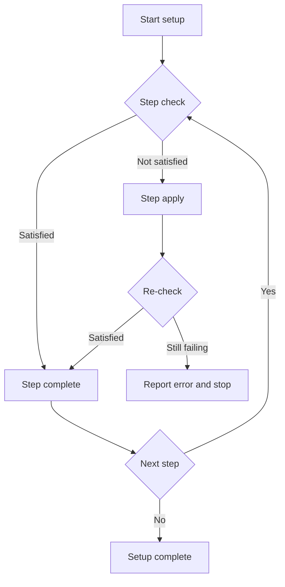
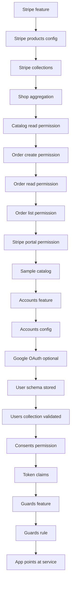

# Service Setup (ulabase.setup.ts)

The `ulabase.setup.ts` file is a declarative setup configuration that defines what a Ulabase service needs to run the shop application. It specifies check and apply steps for every service configuration, ensuring the service is properly configured with all required features, permissions, and data.

## Overview

The setup file replaces manual configuration checklists with executable code. Instead of remembering which settings must match or running multiple scripts, a single command configures the entire service:

```bash
npx @ulabase/cli setup --srv <srvId>
```

With `--dry-run`, it checks what the service is missing without making changes. Every step is idempotent—running against an already-configured service writes nothing and reports each step as satisfied.

## The Check/Apply Pattern

Each configuration step follows a two-phase pattern:

1. **Check**: Examines whether the desired state is already satisfied
2. **Apply**: Configures the service if the check fails

This pattern ensures:
- **Idempotency**: Re-running against a configured service writes nothing
- **Safety**: Checks verify actual state, not just presence of configuration
- **Transparency**: `--dry-run` shows exactly what needs fixing
- **Reliability**: Failed applies can be retried without side effects



*Each step checks desired state, applies only when the check fails, then re-checks so a satisfied step is verified.*

## Step Groups

### Stripe Configuration

The setup installs and configures Stripe for payment processing in three steps: feature installation, products-mode configuration, and collections initialization.

**Products mode** is the configuration the step writes and re-checks:

| Setting | Value | Why |
|---|---|---|
| `enabled` | `true` | Turns products mode on (written inside the `products` block; enabling lives on the feature document itself, set by `installFeature`) |
| `success-url` | `{origin}/orders#order={ORDER_ID}&secret={ORDER_SECRET}` | The order id and secret ride in the **fragment** so the secret never reaches a server log or a Referer header |
| `cancel-url` | `{origin}/cart` | Where a buyer lands when they abandon checkout |
| `session-expires-minutes` | `30` | Stripe's minimum; an abandoned checkout otherwise looks like a live `pending_payment` order for an hour |
| `catalog-collection` | `catalog` | Must match `catalogCollection` in `src/environments/environment.ts` |
| `orders-collection` | `orders` | Must match `catalogOrdersCollection` in `src/environments/environment.ts` |
| `default-currency` | `eur` | Shop currency |
| `notifications` | `order-confirmed` and `order-refunded`, both enabled | Post-payment emails; a shop that never configures these takes people's money and sends them nothing |
| `shipping-address-countries` | ISO 3166-1 alpha-2 list | An empty list means Checkout never shows the address form |

**Secrets** (`STRIPE_SECRET_KEY` / `STRIPE_WEBHOOK_SECRET`) are *named, not held*. The `secret()` helper returns `fromEnv(name)` — a marker whose value is resolved at apply time, on the way to the wire — when the environment variable is set, and otherwise returns whatever the service already stores. The apply does a read-modify-write that passes the redaction placeholders straight back: the server replaces the whole document and restores the stored value for any field still holding one, so stripping "empty-looking" fields would write bullets over the real Stripe key. The check treats a secret named in the environment as unsatisfied until the apply has written it (`wantsReplacing` consults a per-run `pushed` set). Keys are optional for the first run: without them the shop opens with catalog, cart and accounts, and only checkout stays off.

**Collections initialization** runs the feature's `products` initializer, which creates `catalog`, `orders`, `transactions` and their indexes and never overwrites existing data. The honest check is whether the collections exist.

### Shop Aggregation

The catalog's `shop` aggregation is declared on the catalog collection and is the only way the shop queries it — the service takes no `?filter=` from the client. Its first stage is `FOR_SALE` (a permission's `readFilter` does not apply to an aggregation), followed by optional category, exclude, and search stages, then sort/paging.

### ACL Permissions

Five permissions control catalog and order access:

- **Catalog Read** (`catalog-read-anon`): Allows anyone (`$unauthenticated` and `user` roles) to browse purchasable products. The predicate covers the list, one product by id, and the `shop` aggregation; the `readFilter` (`FOR_SALE`) guards the list and documents.
- **Order Creation** (`orders-create-anon`): Allows anyone to place orders via POST only — with PATCH a buyer could set their own order to `status: "paid"`.
- **Order Read** (`orders-read-anon`): Allows reading individual orders with secret verification (`readFilter: { secret: "@qparams['secret']" }`).
- **Order List** (`orders-list-own`): Allows signed-in users to list orders from their billing account. The `readFilter` is `{ 'payer.id': '@team._id' }` — `@team._id` is the active team the **server** resolves at every request; it is not a JWT team claim.
- **Stripe Portal** (`stripe-portal`): Allows signed-in users to access the Stripe billing portal.

### Accounts Configuration

The accounts feature provides authentication:

1. **Feature Installation**: Installs the accounts feature
2. **Configuration**: Sets app name, frontend URLs, and feature flags (registration, verification, password reset, invitations, OAuth) derived from the app's `environment.features`
3. **Google OAuth** (optional): Configures Google OAuth credentials when `oauthLogin` and the `google` provider are enabled in the environment

### User Schema and Validation

A JSON schema validates user documents:

- **Schema Storage**: Stores a schema (`userConsentsSchema`) that defines required fields (`_id`, `roles`). `password` and `profile` are deliberately optional: an invited user is written with no password and an empty profile, so requiring them would refuse every invitation.
- **Collection Validation**: Applies the schema to the `users` collection via its `_meta`
- **Consents Fields**: Includes `latestConsents` (with `tos`, `pp`, `acceptedAt` as a BSON date `_$date`) and `consents` history

### Consents System

The consents system manages legal document acceptance:

1. **Permission** (`userCanPatchOwnConsents`): Allows users to update their own consents via PATCH. The permission's `mergeRequest` stamps the current versions and appends to the `consents` history.
2. **Token Claims**: Ensures `latestConsents/tos` and `latestConsents/pp` are included in authentication tokens (configured via `account-properties-claims` on the `auth` feature). There is no team claim — the orders list `readFilter` reads `@team._id`, which the server resolves at every request.
3. **Guards Rule** (`consentsGate`): Blocks users who haven't accepted current legal versions (HTTP 451).

## Secrets Handling

Secrets are managed with a "variable wins" strategy:

```typescript
const secret = (name: string, stored: unknown) => {
  const fromEnvironment = process.env[name];
  if (fromEnvironment !== undefined && fromEnvironment !== '') {
    pushed.add(name);
    return fromEnv(name);
  }
  return stored;
};
```

**Key principles:**
- `fromEnv` marks a secret for resolution at apply time ("on the way to the wire")
- Environment variables override stored values ("variable wins"): when the variable is set, the function returns `fromEnv(name)` and records the name in the pushed set; otherwise it returns the stored value
- A secret named in the environment is one you are asking to be written, so the step is not satisfied until it has been — `wantsReplacing` consults the pushed set to know this
- Stored secrets read back as bullets (`isRedacted`); empty strings mean never set
- Re-running against a configured service needs no secrets in the environment
- Changing a secret from the environment works by exporting the key and re-running

## SHOPPERS Role Configuration

The shop sells to both guests and signed-in users:

```typescript
const SHOPPERS = ['$unauthenticated', 'user'];
```

**Why one permission with two roles, not two permissions:**

The ACL authorizer matches only the first permission it finds for a request. With two separate permissions:
- `$unauthenticated` alone would break for signed-in users (they'd get 403)
- Two rules for the same path would make which one applies depend on role order

One permission with both roles ensures consistent access regardless of authentication state.

## Catalog Seeding

The setup includes demo products for initial shop display:

- **Content, not configuration**: Seeds only when catalog is empty
- **Never overwrites**: Re-running the setup doesn't reset real data to demo data
- **Idempotent**: Uses upsert to allow partial seeding runs
- **Delete when ready**: Remove the seeding step when the shop becomes yours
- **Checks for emptiness**: The check asks whether the catalog holds anything at all, not whether specific products are present

## Versioned Legal Documents

Legal document versions are managed centrally:

- **TOS_VERSION** and **PP_VERSION** define current versions in `src/legal-versions.ts`
- **Permission stamps** versions when users accept via `mergeRequest`
- **Guards rule** compares token claims against current versions
- **Updating versions** forces re-acceptance on next request
- **Version comparison**: The guard blocks when either acceptance is missing (`not (A and B)`)

## Dependencies and Order

The steps run in a fixed order. Stripe and accounts are logically independent, but the consents steps must follow accounts because they write against the `users` collection the accounts feature owns. The final step, `appPointsAtService`, writes the service URL into the `apiUrl` line of `src/environments/environment.ts`, rewriting only that line so comments and feature flags stay. It runs last on purpose and is exported so extended setups can keep it last: a setup that stopped halfway leaves the "connect your service" screen, not a sign-up page that fails.



*Step order in `ulabase.setup.ts`: Stripe and accounts configure independently, consents steps follow accounts, and the app is pointed at the service only after every other step is in place.*

## Running the Setup

### Basic Usage
```bash
npx @ulabase/cli setup --srv <srvId>
```

### Dry Run (Check Only)
```bash
npx @ulabase/cli setup --srv <srvId> --dry-run
```

### Environment Variables
- `SHOP_ORIGIN`: Where the shop is served from (default: `http://localhost:5173`)
- `APP_NAME`: Shown in emails (default: `Ulabase Shop`)
- `STRIPE_SECRET_KEY`: Stripe secret key
- `STRIPE_WEBHOOK_SECRET`: Stripe webhook secret
- `GOOGLE_CLIENT_ID`: Google OAuth client ID
- `GOOGLE_CLIENT_SECRET`: Google OAuth client secret

## Invariants and Failures

**Key invariants:**
- Every step must be idempotent
- Checks verify actual state, not just presence
- Secrets are resolved at apply time, not check time
- Catalog data is never overwritten by setup runs
- The app is pointed at the service only after all other steps complete

**Failure modes:**
- Missing environment variables cause `fromEnv` to throw at apply time
- Invalid configurations are caught by service validation
- Version mismatches between permission and guards rule cause permanent blocking
- Missing ACL permissions result in 403 errors for specific operations

## Extension Points

The setup can be extended by:
- Adding new steps to the `defineSetup` array
- Modifying the `SHOPPERS` roles for different access patterns
- Updating `SHIPPING_COUNTRIES` for different regions
- Adding new legal document versions
- Customizing the user schema for additional fields
- Exporting the `appPointsAtService` step to keep it last in extended setups

## Configuration/Operations

**Updating legal documents:**
1. Edit `TOS_VERSION` and `PP_VERSION` in `src/legal-versions.ts`
2. Re-run the setup
3. All users will be prompted to accept new versions on next request
4. The acceptance they already gave stays in the `consents` history

**Changing secrets:**
1. Export the environment variable (e.g., `STRIPE_SECRET_KEY`)
2. Re-run the setup
3. The new value will be written to the service

**Adding products:**
1. Edit `src/catalog.seed.json`
2. Re-run setup (only affects empty catalogs)
3. Or manually add products to the catalog collection

## Related Pages

- [Feature Flags](feature-flags.md) - App-side feature toggles that drive setup configuration
- [Stripe Integration](../integrations/stripe.md) - Stripe-specific configuration details
- [Ulabase Service](../integrations/ulabase-service.md) - Service architecture and APIs
- [Consents Gate](../workflows/consents-gate.md) - How the consent gate blocks unaccepted users
- [Billing Accounts](../domains/billing-accounts.md) - Teams, billing accounts, and order filtering by `@team._id`
