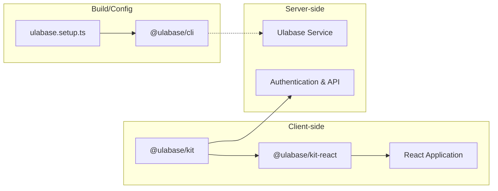
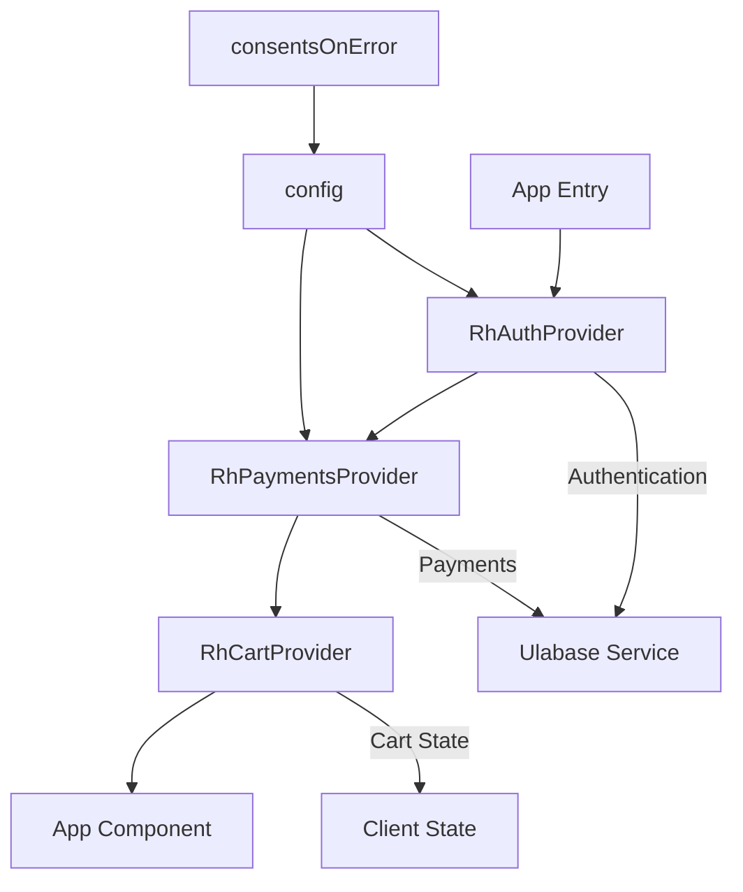
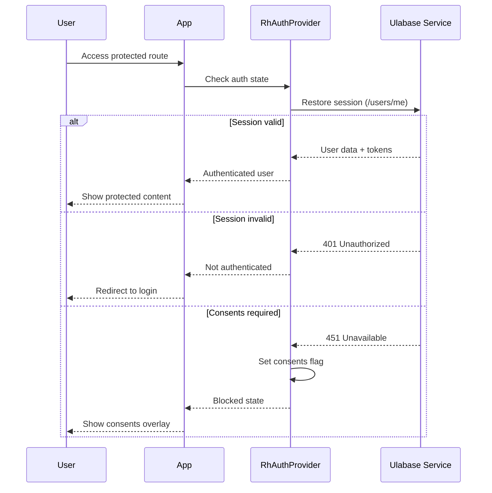

# Ulabase Platform and Kit Packages

Ulabase is a managed service platform that provides backend functionality including authentication, payments, and data storage without requiring developers to build or maintain server-side infrastructure. The ecommerce starter application communicates with a Ulabase service instance via client-side packages, eliminating the need for custom backend code.

## Platform Architecture

### Service Instances

Each Ulabase tenant gets their own service instance at:
```
https://<id>.ulabase.app
```

Where `<id>` is a six-character identifier (e.g., `xxxxxx` in `https://xxxxxx.ulabase.app`). This URL format isolates tenant data and configurations.

### Admin and Console Access

- **Admin Node**: `https://api.ulabase.com` - Ulabase's internal control panel for service management
- **Console**: `https://ulabase.com` - User-facing interface for managing services, issuing personal access tokens, and monitoring

**Important**: The application must point to the tenant's service URL (`https://<id>.ulabase.app`), not the admin node (`api.ulabase.com`). Using the admin URL causes all requests to fail.

## NPM Packages

The Ulabase ecosystem consists of three packages that work together:



*Package relationships: @ulabase/kit provides core logic, @ulabase/kit-react adds React integration, and @ulabase/cli handles service configuration.*

### @ulabase/kit

The core framework-agnostic package that handles authentication and API communication:

- **Authentication Logic**: Manages user sessions, token handling, and authentication flows
- **API Communication**: Provides authenticated API access to Ulabase services
- **Error Handling**: Implements standardized error responses via `ApiError` objects with `status` and `message` properties
- **Token Management**: Handles JWT token storage, refresh, and automatic attachment to requests

*Note*: This package is a transitive dependency of `@ulabase/kit-react` and not installed directly in the starter.

### @ulabase/kit-react

React-specific integrations built on top of `@ulabase/kit`:

- **Context Providers**:
  - `RhAuthProvider`: Authentication context provider that wraps the application
  - `RhPaymentsProvider`: Stripe payments integration context
  - `RhCartProvider`: Shopping cart state management context

- **Hooks**:
  - `useAuth()`: Access authentication state, user data, and API methods
  - `usePayments()`: Access payment processing and Stripe portal functionality
  - `useCart()`: Access cart state and operations

- **Route Guards**:
  - `AuthGuard`: Protects routes requiring authentication
  - `PublicGuard`: Redirects authenticated users away from public routes

- **Utility Functions**:
  - `formatPrice()`: Formats currency amounts for display
  - `isValidApiBaseUrl()`: Validates Ulabase service URLs
  - `setToken()`, `scheduleRefresh()`: Manual token management utilities

### @ulabase/cli

Command-line interface for service setup and configuration (devDependency):

- **`defineSetup()`**: Declarative setup configuration function
- **`step()`**: Defines check/apply pairs for idempotent configuration
- **`fromEnv()`**: Resolves environment variables at apply time
- **`setup` command**: `ulabase setup --srv <srvId>` executes the setup configuration
- **`--dry-run`**: Checks what needs configuration without making changes

## Integration with the Ecommerce Starter

### Provider Architecture

The application integrates Ulabase through a nested provider structure:

```typescript
// src/main.tsx
const config = {
  apiBaseUrl: environment.apiUrl, // e.g., 'https://xxxxxx.ulabase.app'
  payments: true,
  onError: consentsOnError,
};

createRoot(document.getElementById('root')!).render(
  <StrictMode>
    <BrowserRouter>
      <RhAuthProvider config={config}>
        {/* Must sit inside RhAuthProvider — it reads the user from it. */}
        <RhPaymentsProvider config={config}>
          <RhCartProvider>
            <App />
          </RhCartProvider>
        </RhPaymentsProvider>
      </RhAuthProvider>
    </BrowserRouter>
  </StrictMode>
);
```



*Provider nesting hierarchy: RhAuthProvider must wrap RhPaymentsProvider because payments reads the authenticated user from it.*

### Authentication Flow

1. **Login/Signup**: Users authenticate via `/auth/*` endpoints handled by the kit
2. **Token Management**: Kit automatically manages JWT tokens and refresh cycles
3. **Session Restoration**: `RhAuthProvider` restores sessions on app load
4. **Consents Gate**: Enforces legal document acceptance for authenticated users



*Authentication flow with consents gate: 451 responses trigger the consents overlay without affecting authentication state.*

### API Access

The kit provides authenticated API access through `auth.api()`:

```typescript
import { useAuth } from '@ulabase/kit-react';
import type { ApiError } from '@ulabase/kit-react';

function Notes() {
  const auth = useAuth();
  const [notes, setNotes] = useState<unknown[]>([]);
  const [error, setError] = useState<string | null>(null);

  useEffect(() => {
    auth.api('/notes?pagesize=10')
      .then(res => res.json())
      .then(setNotes)
      .catch((err: ApiError) => setError(err.message));
  }, [auth.api]);

  // ...
}
```

**Key Features**:
- Pass paths, not full URLs (relative to service base URL)
- Automatic session bearer token attachment
- Non-2xx responses reject with `ApiError` containing `status` and `message`
- Use for custom collection reads (e.g., `/notes`, `/catalog`, `/orders`)

## Development Workflow

### Local Kit Development

When developing or modifying `@ulabase/kit` or `@ulabase/kit-react`:

1. **Link the packages globally**:
   ```bash
   cd ../restheart-cloud-kit/packages/kit       && npm link
   cd ../kit-react                              && npm link
   ```

2. **Point the application at them**:
   ```bash
   cd ../../../ulabase-starter-ecommerce
   npm link @ulabase/kit @ulabase/kit-react
   ```

3. **Rebuild after changes**:
   ```bash
   cd ../restheart-cloud-kit && npm run build
   ```

### Vite Configuration for Linked Packages

When using linked packages, add these settings to `vite.config.ts`:

```typescript
export default defineConfig({
  resolve:     { dedupe: ['react', 'react-dom', 'react-router-dom'] },
  optimizeDeps: { exclude: ['@ulabase/kit', '@ulabase/kit-react'] },
  server:      { fs: { allow: ['..'] } },
});
```

**Purpose**:
- `dedupe`: Prevents multiple React instances (linked packages resolve from their real path)
- `optimizeDeps.exclude`: Prevents Vite from snapshotting symlinked dependencies
- `server.fs.allow`: Permits serving sources from outside project root

### Important Notes

- **`npm install` undoes linking** - Re-run `npm link` commands after any install
- **Rebuild required** - The app consumes `dist/`, not TypeScript sources
- **Clear Vite cache** - Delete `node_modules/.vite` when switching between linked/unlinked modes
- **Check symlinks** - Verify with `ls -l node_modules/@ulabase/` (should show symlinks, not directories)

## Service Configuration

### Setup Process

The `ulabase.setup.ts` file defines declarative check/apply steps for service configuration:

```bash
# Check what needs configuration
npx @ulabase/cli setup --srv <srvId> --dry-run

# Apply configuration
npx @ulabase/cli setup --srv <srvId>
```

### Configuration Areas

1. **Stripe Integration**: Payment processing, webhooks, success/cancel URLs
2. **Account Features**: Registration, verification, password reset, OAuth
3. **ACL Permissions**: Catalog access, order creation/reading, user permissions
4. **Guards Rules**: Consents enforcement, user blocking conditions
5. **User Schema**: Validation rules for user documents
6. **Collections**: Orders, transactions, catalog with proper indexes

### Environment Variables

Secrets are named, not held:

```bash
export STRIPE_SECRET_KEY=sk_test_...
export STRIPE_WEBHOOK_SECRET=whsec_...
```

The setup process reads these at apply time and only when not already configured. Re-running against a configured service needs no secrets in the environment.

## Error Handling

### ApiError Responses

Non-2xx HTTP responses from the Ulabase service reject with `ApiError` objects:

```typescript
catch((err: ApiError) => {
  if (err.status === 403) {
    // Handle forbidden access
  } else if (err.status === 451) {
    // Handle consents requirement
  } else {
    setError(err.message);
  }
});
```

**Properties**:
- `status`: HTTP status code
- `message`: Human-readable error description

### Common Error Scenarios

- **401 Unauthorized**: Missing or invalid authentication token
- **403 Forbidden**: Insufficient permissions for the requested operation
- **451 Unavailable for Legal Reasons**: User hasn't accepted current legal documents
- **409 Conflict**: Resource already exists (e.g., feature installation)

## Relationships and Dependencies

### Package Dependencies

```
@ulabase/kit-react
  └── @ulabase/kit
      └── (framework-agnostic core)

@ulabase/cli
  └── (standalone CLI tool)
```

### Service Integration

```
Ecommerce Starter
  ├── @ulabase/kit-react (client-side)
  │   └── @ulabase/kit (core logic)
  └── Ulabase Service (https://<id>.ulabase.app)
      ├── Authentication endpoints
      ├── Payment processing
      ├── Data storage
      └── Feature configuration
```

### Configuration Flow

```
ulabase.setup.ts
  └── @ulabase/cli
      └── Ulabase Admin Node (api.ulabase.com)
          └── Tenant Service Configuration
```

## Extension Points

### Custom Collections

Use `auth.api()` to access application-specific collections:

```typescript
// Read custom collection
const notes = await auth.api('/notes').then(res => res.json());

// Write to custom collection (with proper permissions)
await auth.api('/notes', {
  method: 'POST',
  body: JSON.stringify({ title: 'New Note', content: '...' }),
});
```

### Custom Features

Extend the setup configuration with additional steps:

```typescript
export default defineSetup('Ecommerce', [
  // Existing steps...
  
  step('custom feature configured', {
    check: ({ service }) => service.featureExists('custom-feature'),
    apply: ({ service }) => service.installFeature('custom-feature'),
  }),
]);
```

## Configuration and Operations

### Service URL Configuration

Set in `src/environments/environment.ts`:

```typescript
apiUrl: 'https://xxxxxx.ulabase.app',
```

### Feature Flags

Match service configuration in `src/environments/environment.ts`:

```typescript
export const environment = {
  apiUrl: 'https://xxxxxx.ulabase.app',
  features: {
    emailRegistration: true,
    oauthLogin: false,
    passwordReset: true,
    teamInvitations: true,
  },
  // ...
};
```

### Personal Access Tokens

For CLI authentication:
1. Open [ulabase.com](https://ulabase.com)
2. Navigate to profile settings
3. Issue a personal access token (carries `cli` role)
4. Use with `ulabase login`

**Note**: Tokens are not account passwords and can be revoked without affecting other access.

## Testing and Validation

### Dry Run

Check service configuration without changes:

```bash
npx @ulabase/cli setup --srv <srvId> --dry-run
```

### Health Checks

Common validation steps:
1. Verify `apiUrl` points to correct service instance
2. Test authentication with `ulabase login`
3. Check Stripe webhook configuration
4. Validate ACL permissions for guest access

### Debugging

- **Empty shop**: Catalog has no products with `purchasable: true`
- **Login loops**: `apiUrl` pointing to `api.ulabase.com` instead of service
- **Pending orders**: Webhook not arriving (check Stripe event delivery)
- **Hook errors**: Multiple React instances from improper linking

## Security Considerations

### Token Security

- JWT tokens are base64-encoded, not encrypted
- Sensitive data shouldn't be stored in token claims
- Token refresh happens automatically via kit
- Personal access tokens have limited `cli` role

### ACL Design

- Single permission per role combination (not multiple documents)
- Priority determines which permission applies
- ReadFilters enforce data isolation
- Guest and user access handled in same permission

### Consents Enforcement

The consents system enforces legal document acceptance through a three-part mechanism:

1. **Server-side Guards rule**: Blocks requests from users who haven't accepted current legal documents with HTTP 451 status
2. **Client-side signal**: `consents-signal.ts` watches for 451 responses and raises a blocking flag
3. **UI overlay**: `ConsentsGate.tsx` sits above the router and shows acceptance form when flag is raised

```typescript
// src/consents-signal.ts - The consents gate, client side
export const consentsOnError = (err: ApiError): void => {
  if (err.status === 451) setBlocked(true);
};
```

**Key behaviors**:
- Session restoration (`/users/me`) is the first request that trips the gate
- Guest users bypass consents (no user document to stamp)
- Versions are compared, not just presence (bumping versions requires no client changes)
- The gate sits above the router because `AuthGuard` would block unreachable content
