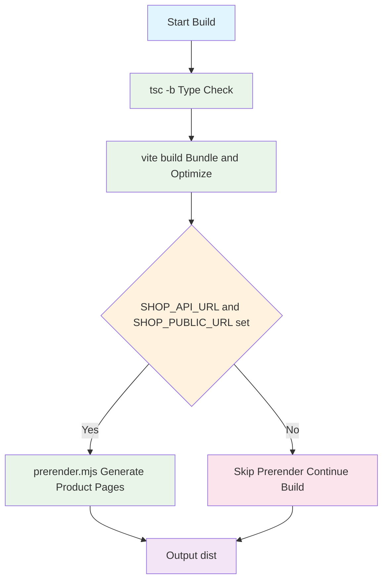

# Configuration and Deployment

This page covers how the Ulabase Starter Ecommerce app is configured, built, previewed, and deployed as a static site. The app uses Vite for bundling, a prerender script for SEO optimization, and can be hosted on any static hosting service with proper URL rewriting.

For service-side setup (Stripe keys, collections, ACL), see [Service Setup](../concepts/service-setup.md). For reskinning and theming, see [Customization and Theming](customization.md).

## Environment Configuration

The app's runtime configuration lives in `src/environments/environment.ts`. This file controls the API endpoint, collection names, and feature flags.

### Core Properties

```typescript
export const environment = {
  // Your free Ulabase service, e.g. 'https://<srvid>.ulabase.app'.
  // `npx ulabase setup --srv <srvid>` writes it here for you. Empty in the
  // starter's own repository: empty shows the "configure your service" screen.
  apiUrl: '',

  /**
   * Collection names are configured per service
   * (`stripeConfig.products.catalog-collection` / `.orders-collection`), and the
   * interceptors match on the *configured* name — so the HTTP path really does
   * change if a deployment renamed them. These are the defaults the service
   * uses when it hasn't.
   */
  catalogCollection: 'catalog',
  catalogOrdersCollection: 'orders',

  features: {
    emailRegistration: true,
    passwordReset: true,
    oauthLogin: false, // Google sign-in: off until you create its OAuth client (README, "Google sign-in")
    oauthProviders: ['google'] as const,
    teamInvitations: true,
  },
};
```

**Critical**: `apiUrl` must point to your tenant service (e.g., `https://xxxxxx.ulabase.app`), not the admin node (`api.ulabase.com`). The app validates this at startup and shows a configuration screen if the URL is empty or not a valid service address.

Collection names are not free-form labels on the client: `catalogCollection` and `catalogOrdersCollection` must match the names configured on the Ulabase service, because the shop requests and the kit interceptors use the configured name as the HTTP path.

### Feature Flags

`environment.features` gates which authentication and team-management routes and UI are reachable, and those flags must match the corresponding toggles on your Ulabase service. See [Feature Flags and Environment Configuration](../concepts/feature-flags.md) for flag-by-flag behavior, route gating, and mismatch symptoms.

## Build Pipeline

The npm scripts in `package.json` are the entrypoints:

| Command | What it runs | When to use it |
|---|---|---|
| `npm run dev` | `vite` | Local development server |
| `npm run build` | `tsc -b && vite build && node scripts/prerender.mjs` | Production build in `dist/` |
| `npm run preview` | `vite preview` | Serve the production build locally |
| `npm run test` | `vitest` | Unit tests |

```bash
npm run build
```

This runs three sequential steps:

1. **`tsc -b`**: TypeScript type checking
2. **`vite build`**: Production bundling and asset optimization
3. **`node scripts/prerender.mjs`**: SEO prerendering (writes product pages when the required environment variables are set, otherwise skips)



*The build pipeline: type checking, bundling, and optional SEO prerendering.*

### Vite Configuration

The Vite config (`vite.config.ts`) is minimal:

```typescript
import { defineConfig } from 'vite';
import react from '@vitejs/plugin-react';

export default defineConfig({
  plugins: [react()],
});
```

When linking local kit packages for development, add these settings back:

```typescript
resolve: { dedupe: ['react', 'react-dom', 'react-router-dom'] },
optimizeDeps: { exclude: ['@ulabase/kit', '@ulabase/kit-react'] },
server: { fs: { allow: ['..'] } },
```

`resolve.dedupe` keeps a single React copy when linked packages resolve their own imports from their real path; `optimizeDeps.exclude` stops Vite from snapshotting symlinked kit packages; `server.fs.allow` lets the dev server read the linked package outside the app root. After switching between linked and registry packages, stop the dev server and delete `node_modules/.vite` so Vite re-resolves modules. See [Ulabase and Kit](../concepts/ulabase-and-kit.md) for the local kit workflow.

## SEO Prerendering

The prerender script (`scripts/prerender.mjs`) generates static HTML files for each product, enabling link previews on platforms that don't execute JavaScript (Slack, WhatsApp, X, LinkedIn). Full background is in `SEO.md`.

### How It Works

1. **Reads the catalog** from your live Ulabase service (paged requests of the configured collection)
2. **Generates `dist/product/<id>/index.html`** for each product by substituting product-specific `<head>` tags into the same app shell as `dist/index.html`
3. **Creates `sitemap.xml`** listing all product URLs
4. **Creates `robots.txt`** with sitemap reference

Each generated HTML file contains:
- Product-specific `<title>`, description, and Open Graph tags
- Schema.org `Product` JSON-LD structured data (price, availability, images)
- The same app shell as `dist/index.html`

The prerendered `<head>` is a snapshot: price and availability stay stale in a crawler's copy until the next run. Human visitors always get the live SPA.

### Environment Variables

Prerendering requires two environment variables:

```bash
SHOP_API_URL=https://xxxxxx.ulabase.app \
SHOP_PUBLIC_URL=https://ilmionegozio.com \
npm run build
```

- **`SHOP_API_URL`**: Your Ulabase service URL
- **`SHOP_PUBLIC_URL`**: Your public website URL (used for canonical URLs and sitemap)
- **`SHOP_CATALOG_COLLECTION`**: Optional, defaults to `catalog`
- **`SHOP_SHELL`**: Optional, set to `remote` to fetch shell from deployed site

**Graceful degradation**: If `SHOP_API_URL` or `SHOP_PUBLIC_URL` are not set, the script skips itself and the build continues without prerendering.

### SHOP_SHELL=remote Mode

For scheduled refreshes without rebuilding:

```bash
SHOP_SHELL=remote \
SHOP_API_URL=https://xxxxxx.ulabase.app \
SHOP_PUBLIC_URL=https://ilmionegozio.com \
node scripts/prerender.mjs
```

This fetches `index.html` from your deployed site instead of `dist/`, so you can update product data without running `npm install` or `vite build`. After a remote refresh, upload `dist/product/` and `sitemap.xml` to the host.

## Static Hosting Requirements

The output of `npm run build` is a static site in `dist/` (SPA shell, hashed assets, and optional prerendered product pages). `npm run preview` serves that output locally for a smoke test before upload.

### S3 + CloudFront Deployment

S3 requires specific configuration for SPA routing:

#### 1. Extensionless URLs

The canonical URL is `/product/<id>` (no trailing slash), but the file is at `product/<id>/index.html`. Use a CloudFront function on viewer-request:

```javascript
async function handler(event) {
    var request = event.request;
    var uri = request.uri;
    
    // Check whether the URI is missing a file name.
    if (uri.endsWith('/')) {
        request.uri += 'index.html';
    }
    // Check whether the URI is missing a file extension.
    else if (!uri.includes('.')) {
        request.uri += '/index.html';
    }
    
    return request;
}
```

The plain S3 website endpoint is not a substitute: it redirects `/product/<id>` to the trailing-slash form, so the crawled address stops matching the declared canonical.

#### 2. SPA Routes

Routes like `/cart` and `/orders` have no generated file. Configure custom error responses:
- 403 → `/index.html` (response code 200)
- 404 → `/index.html` (response code 200)

#### 3. Cache-Control Headers

Use tiered TTLs to avoid invalidations:

```bash
# Static assets (immutable)
aws s3 sync dist/ s3://$BUCKET/ --delete \
  --exclude "*.html" --exclude "sitemap.xml" --exclude "robots.txt" \
  --cache-control "public,max-age=31536000,immutable"

# HTML and sitemap (short-lived)
aws s3 sync dist/ s3://$BUCKET/ --delete \
  --exclude "*" --include "*.html" --include "sitemap.xml" --include "robots.txt" \
  --cache-control "public,max-age=60,stale-while-revalidate=2592000"
```

**Why no invalidations**: HTML refreshes itself via short TTL. Static assets are content-hashed by Vite, so new filenames = new cache entries. On a `SHOP_SHELL=remote` refresh, keep `--delete` scoped to `product/` so the run does not remove the rest of `dist/`.

### Verification

Test that prerendered pages are served correctly:

```bash
curl -s https://ilmionegozio.com/product/mug-enamel | grep '<title>'
```

- Product name = working
- Generic shop title = rewrite is eating the pages

## Presentation Defaults

Two runtime defaults affect deployable UI behavior. Deep theming and replacement belong in [Customization and Theming](customization.md); the operations-relevant facts are:

- **`src/styles.css`** is a disposable default skin: section 1 is the design token vocabulary, and sections 3–5 are skin classes that templates reference through semantic hooks (`.card`, `.btn-primary`, `.form-field`, and similar). Re-theme from the tokens or replace the skin wholesale.
- **`src/viewport-height.ts`** writes `--vh` (one percent of the visible viewport) from `visualViewport`, updated on resize and safe to call when there is no `window`. CSS should use `height: calc(var(--vh, 1vh) * 100)` so full-height layouts account for mobile browser chrome and the on-screen keyboard. Native `dvh` tracks chrome but ignores the keyboard, which is the half that breaks login forms.

## Deployment Checklist

1. **Configure environment.ts**: Set `apiUrl` and collection names
2. **Set feature flags**: Match service configuration
3. **Run build**: `npm run build`
4. **Preview locally**: `npm run preview`
5. **Configure hosting**: S3/CloudFront or other static host
6. **Set up URL rewriting**: Extensionless URLs for product pages
7. **Configure error responses**: SPA routes return `index.html`
8. **Set cache headers**: Tiered TTLs for HTML vs static assets
9. **Verify prerendering**: Test product page titles
10. **Schedule refreshes**: Optional cron for `SHOP_SHELL=remote` mode

## Troubleshooting

### "Configure your service" screen
- Check `apiUrl` in `environment.ts`
- Ensure URL is `https://xxxxxx.ulabase.app` (not `api.ulabase.com`)

### Prerender skipped
- Set `SHOP_API_URL` and `SHOP_PUBLIC_URL` environment variables
- Check service is accessible and catalog collection exists

### Product pages show generic title
- Verify CloudFront function is rewriting URLs correctly
- Check custom error responses are configured
- Test with `curl` to see what HTML is returned

### Mobile keyboard covers form fields
- Ensure `trackViewportHeight()` is called (it is mounted from `App`)
- Use `calc(var(--vh, 1vh) * 100)` for full-height layouts

### Invalid hook call after linking kit packages
- Restore the Vite `dedupe` / `optimizeDeps` settings above
- Delete `node_modules/.vite` and restart the dev server
