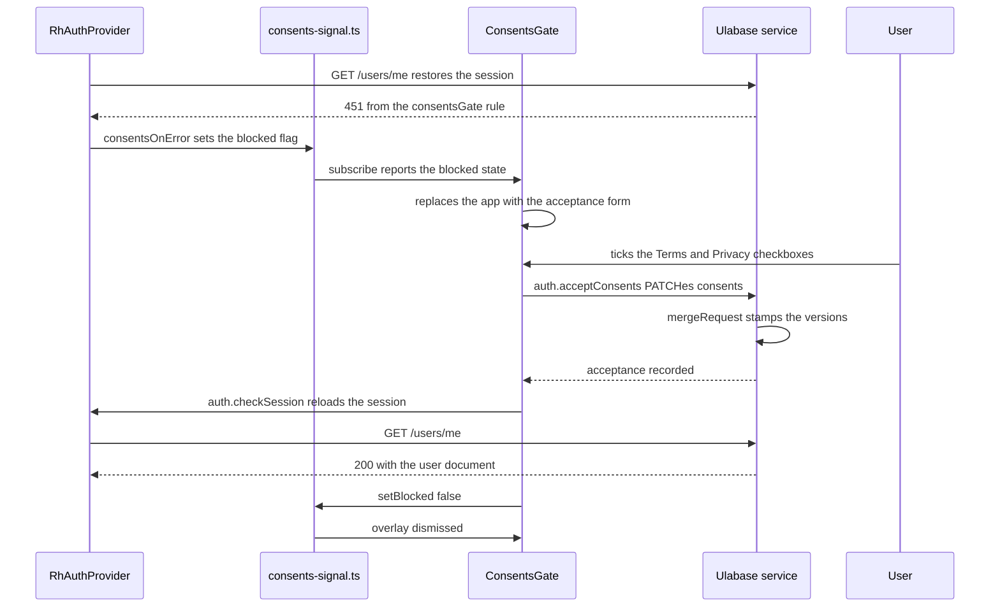

# Consents Gate Flow

The consents gate ensures that registered users cannot use the application until they have accepted the current versions of the Terms of Service (TOS) and Privacy Policy (PP). The flow involves client-side UI and server-side enforcement working together.

## Why the Gate is Above the Router

The `ConsentsGate` component sits **above the router** in the component hierarchy because:

- A blocked user has **no valid session** — the server refuses `/users/me` with a 451 status.
- If the gate were inside the router, `AuthGuard` would see the missing session and bounce the user to the login page.
- The login page itself would also be blocked because authentication endpoints are exempt, but the subsequent session check would fail again.
- Placing the gate above the router ensures the user sees the acceptance form rather than being stuck in a redirect loop.

## Guests Are Never Blocked

Guest users (anonymous visitors) are **never blocked** by the consents gate because:

- Guests have no user document in the database to stamp with consent versions.
- The guard rule uses `@authenticated` to skip anonymous requests entirely.
- A guest holds no token, so `checkSession` short-circuits without a request and the client never raises the blocked flag. The shop stays browsable and buyable for them, which is the point of keeping the gate outside `AuthGuard`.

Nothing in this starter records a guest's acceptance: the cart starts Stripe checkout with order items only, and the order carries no consent data. Guest consent is therefore not comparable to the stamped, versioned acceptance a registered user gives.

## Three-Part Architecture

The consents gate consists of three interconnected components:

1. **`consents-signal.ts`** — A pub/sub flag that tracks whether the user is blocked.
2. **`ConsentsGate.tsx`** — The UI overlay that replaces the app when blocked.
3. **Guards rule `consentsGate`** — Server-side enforcement that answers **451** to a *signed-in* user whose `latestConsents` do not match the current versions. Anonymous requests pass.

## Sequence Diagram



*Session restore trips the gate with a 451, and the overlay clears only after a successful acceptance reloads the session.*

## Legal Paths Exemption

The paths `/terms` and `/privacy` are exempt from the consents gate **overlay** — the exemption is client-side only:

- A user must be able to read the legal documents before agreeing to them.
- `LEGAL_PATHS` in `ConsentsGate.tsx` returns the routed children unchanged for those paths, and `routes.tsx` renders the two legal routes normally while the gate is up.
- The server rule knows nothing of these SPA routes; it continues to answer 451 to the API requests that matter.

## Single Source of Truth: `legal-versions.ts`

The file `src/legal-versions.ts` contains the canonical versions of both documents:

```typescript
export const TOS_VERSION = '2026-07-01';
export const PP_VERSION = '2026-07-01';
```

This file is imported by:
- **`ulabase.setup.ts`** — to stamp versions in the permission and to build the guard rule's condition.
- **Legal pages** — `Terms.tsx` and `Privacy.tsx` print the version the reader is looking at.
- **Other components** — to reference the versions when needed.

**Why this matters:** Having versions in one place prevents mismatches between what the server expects and what the client shows. When you publish new documents, edit these strings and re-run the setup — every user will meet the acceptance form again on their next request, and the version they accept is the version the pages show.

## Client-Side Components

### `consents-signal.ts`

This module implements a simple pub/sub pattern to track the blocked state:

- **`isBlocked()`** — Returns the current blocked state.
- **`setBlocked(next)`** — Updates the state and notifies listeners.
- **`subscribe(listener)`** — Registers a listener for state changes; returns an unsubscribe function.
- **`consentsOnError`** — Error handler passed as `config.onError`; sets `blocked = true` when a 451 status is received. Session restoration failures are absorbed by the provider, so this is the only place that gets to see why it failed — without it, "blocked" and "signed out" would look identical to the app.

The same `config` object is given to `RhPaymentsProvider` as well as `RhAuthProvider` in `main.tsx`, and that sharing is deliberate: a 451 on an order is the same refusal as a 451 on `/users/me`, and should raise the acceptance overlay rather than surface as a checkout failure the buyer cannot act on.

### `ConsentsGate.tsx`

The main component that:
- Wraps the routed element in `App.tsx` (`<ConsentsGate>{element}</ConsentsGate>`), above the router.
- Replaces the whole app with an acceptance form while the blocked flag is up.
- Renders two checkboxes (TOS and PP) that gate the accept button and nothing else.
- Shows links to `/terms` and `/privacy` (readable while blocked).
- Calls `auth.acceptConsents()` when both boxes are checked. The request carries no versions — the server stamps them.
- Reloads the session via `auth.checkSession()` after successful acceptance, then clears the blocked flag.
- If the overlay is showing on an `/auth` path (the usual case: the login request itself was refused), it sends the user to `/` instead, so the app starts from its home.
- Provides a "Sign out" option, which clears the blocked flag *before* logging out — otherwise the next user to sign in on that tab would meet the overlay before making a single request.

**Key design decisions:**
- The overlay has no close button or backdrop click — only accepting or signing out can dismiss it.
- The overlay is not `aria-modal` because it replaces the app rather than floating over it, and the footer below it is real content a screen reader should still reach.
- The footer remains visible outside the gate, on every screen including the acceptance form.
- The overlay is user experience, not enforcement: remove it with the dev tools and every request still comes back 451. The rule lives on the server.

## Server-Side Enforcement

### User Document Shape

The `userConsentsSchema` (`SCHEMA_ID`), attached to `/users` by the setup, declares `latestConsents` (with `tos` and `pp` required) and the `consents` array — but requires **none** of them, nor the team fields. That is deliberate: the document is validated as it is inserted, before the initial team is attached and before any acceptance exists, so a schema demanding `latestConsents`, `consents` or the team fields would reject every registration and every invitation.

`acceptedAt` is declared with the escaped `_$date` type key so it is stored as a BSON date. Declared as a plain string, every acceptance is rejected.

### Guards Rule

The rule is written into the **guards** feature config under the id `consentsGate` (`RULE_ID` in `ulabase.setup.ts`) by the setup step "the gate blocks users who have not accepted", which then re-reads the config and compares the condition and status so a drifted install shows up as work outstanding.

- **Condition** (five clauses joined with `and`):
  1. `equals(@authenticated, 'true')` — nobody signed in, nothing to guard. This one line replaces a hand-kept list of public paths.
  2. `not path-prefix('/auth')` and `not path-prefix('/token')` — signing in and fetching a token are authenticated requests made by someone who has not accepted yet; guard those and a blocked user cannot get back in.
  3. `not (method(PATCH) and path-template('/users/{userId}') and bson-request-whitelist(consents))` — the acceptance itself, made *while still blocked*.
  4. `not (equals(@user.latestConsents.tos, '<TOS version>') and equals(@user.latestConsents.pp, '<PP version>'))` — blocked when **either** acceptance is missing. This is deliberately `not (A and B)`, never `not A and not B`, which would block only the users who accepted neither document.
- **`/users/me` is deliberately not excluded.** Blocking it is what makes the gate work with no probing on the client's side: reading the user document is the first thing any app does.
- **Action:** `block`, with `status_code: 451` (Unavailable For Legal Reasons) and a message telling the user they must accept the current documents. 451 is what `src/consents-signal.ts` keys on.
- **Error handling:** `on_error: 'allow'` — a rule that cannot be evaluated must not lock everyone out.

### Permission for Acceptance

A specific permission (`userCanPatchOwnConsents`, `PERMISSION_ID`) allows users to update their own consents. The setup step "the acceptance is permitted, and nothing else is" installs it and compares the stamped versions against `TOS_VERSION` / `PP_VERSION`, because the rule and the permission are a pair: a stamp left on an old value after the rule moves on locks the user out of a form that told them it worked.

- **Predicate:** `path-template('/users/{userId}') and method(PATCH) and (equals(@user._id, ${userId}) or equals(@user.sub, ${userId})) and bson-request-whitelist(consents)` — the authenticated user's own document, and only the `consents` field.
- **Roles:** `user`, priority 1.
- **`mongo.mergeRequest`** stamps the current versions and timestamp (the `accepted` constant: `{ tos, pp, acceptedAt: '@now' }`) onto `latestConsents`, and `$push`es the same object into the `consents` array so the history grows instead of being overwritten. `latestConsents` is written as a nested object, never as dotted keys — MongoDB refuses a request that both sets a field and a path inside it.
- Nothing authorises `PATCH /users/{userId}` out of the box, and a guard never gets a say on a request the ACL already refused. Without this permission the acceptance is a 403 and the user is locked out for good.

### Token Claims

The guard reads the token, not the database, so two account properties travel in the JWT:

- `latestConsents/tos`
- `latestConsents/pp`

They are listed in the `CLAIMS` constant and configured on the always-on **`auth`** feature as `account-properties-claims`, through `getFeatureConfig` / `updateFeatureConfig` in the setup step "the two claims travel in the token" (added to whatever claims the service already carries, never replacing them). Only these two: a JWT payload is base64, not encrypted, so everything in it is readable by anyone holding the token — and the `consents` history in particular grows at every acceptance while no decision reads it.

The version comparison in the rule then needs no database lookup. **A missing claim compares false for every token-authenticated user for ever** — including the ones who just accepted — and blocks them permanently while the condition looks perfectly reasonable. That is the failure the claims step exists to prevent.

> **Note:** The orders list readFilter needs no team claim: it reads `@team._id`, the active team the server resolves at every request, whatever the token carries. See the `CLAIMS` constant beside `ORDERS_FILTER` in `ulabase.setup.ts`.

## Flow Summary

1. **App loads** → `RhAuthProvider` restores session by calling `/users/me`.
2. **Server checks** → The `consentsGate` rule verifies the user has accepted the current versions.
3. **451 response** → If not accepted, server returns 451.
4. **`consentsOnError`** → Sets the blocked flag in `consents-signal.ts`.
5. **`ConsentsGate`** → Subscribes to the blocked state, shows the acceptance form.
6. **User accepts** → Checks both boxes, clicks "I accept".
7. **`auth.acceptConsents()`** → PATCHes the user document's `consents` field, stating nothing about what is accepted.
8. **Permission stamps** → The server updates `latestConsents` with the current versions and timestamp, and appends to the history.
9. **Session restored** → `auth.checkSession()` reloads user data (or the gate sends the user to `/` when it opened on an `/auth` path).
10. **Gate dismissed** → `setBlocked(false)` hides the overlay, the normal app renders.

## Configuration

To update legal documents:
1. Edit `src/legal-versions.ts` with new version strings.
2. Re-run the setup: `npx @ulabase/cli setup --srv <srvId>`.
3. All users will see the acceptance form again on their next request. The acceptances they already gave stay in the `consents` history.

The consents steps **compare configured values rather than mere presence** — the rule's condition string and status, the versions stamped on the permission, and the membership of `account-properties-claims`. After a version bump they therefore report as unsatisfied until re-applied, which is exactly the signal you want; a check that only asked "does it exist" would leave the stamp on the old value while the rule demands a new one.

There are no automated tests for the gate itself; these check/apply steps are the executable specification of the server side.

## Error Handling

- **Network failures:** The acceptance form shows a generic error message.
- **Server errors:** The permission's `mergeRequest` decides what is accepted; the client sends minimal data, so there is little to validate.
- **Missing token claims:** The guard rule compares the claims and, if they are missing, blocks by default — legally fail-safe, operationally fail-closed (see [Token Claims](#token-claims)).

## Security Considerations

- **Versions are server-side:** The client never sends version numbers — the server stamps them, so an acceptance cannot be backdated or aimed at documents the user was never shown.
- **Acceptance history:** All acceptances are recorded with timestamps and kept, not overwritten.
- **Legal paths:** Terms and privacy pages remain readable while the overlay is up (a document you cannot open is a document you cannot agree to).
- **The overlay is not enforcement:** The rule lives on the server; every request from an unaccepted user still comes back 451.
- **Guest isolation:** Guests are never blocked and are not stamped; nothing in this starter records a guest's acceptance.

## See also

- [Service Setup](../concepts/service-setup.md) — how `ulabase.setup.ts` installs the schema, the permission, the claims and the rule as check/apply steps.
- [Ulabase Service](../integrations/ulabase-service.md) — the Guards feature and feature configuration the rule lives in.
- [Authentication and Invitation Flows](auth-and-invitations.md) — session restoration, sign-in and `/users/me`, which is where the gate trips.
- [End-to-End Purchase Flow](purchase-flow.md) — guest purchases, which bypass the gate entirely.
- [Billing Accounts](../domains/billing-accounts.md) — account screens a blocked user never reaches while the gate is up.
